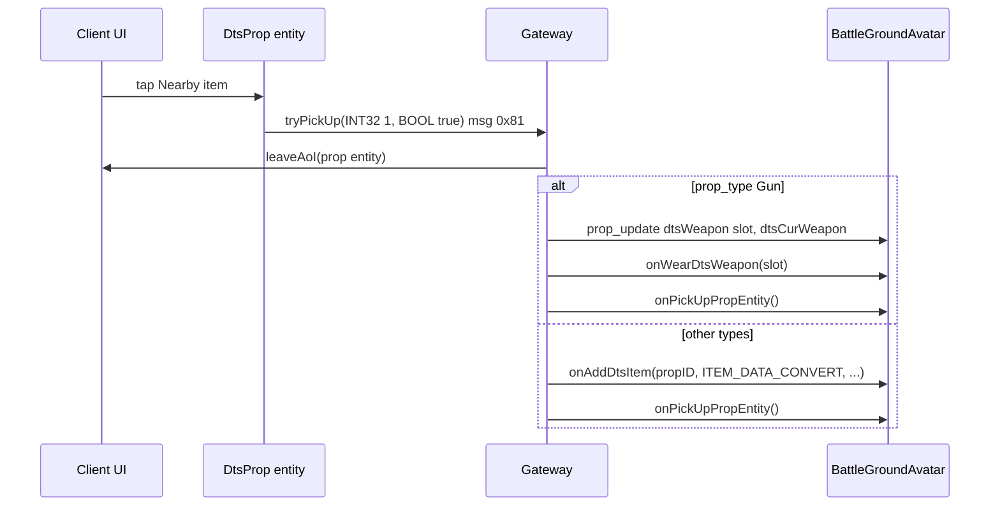

# Loot and pickup (map 700, DtsProp)

Research deliverable for **RO-065**. Records what the gateway already proved on the emulator, where prop ids come from on the original client, and what is still unknown about official loot placement.

**Compatibility:** `compatibility_status` for original-server loot layout remains **unknown**. Local gateway tests are evidence for this server's wire behaviour only (`docs/LOOT_AND_PICKUP.md` does not claim parity with NetEase spawn tables).

---

## 1. World entity: `DtsProp` (client type 140)

Ground loot is a **`DtsProp`** Mercury entity, not a scene object or `AutoRoyaleProp`.

| Item | Source |
|------|--------|
| Entity type id | 140 (`server/extract/client_entity_types.json`) |
| Create payload size | 65 bytes default property stream (`docs/CREATE_ENTITY_FORMAT.md`) |
| Entity id convention (gateway) | `>= 30000` (`battle_flow.PROP_BASE`, `server/battle/session.py`) |
| Parent interfaces | Standard `DtsProp` def; pick animation / package hooks on the player use **`iDtsProp`** on `BattleGroundAvatar` (`docs/LOBBY_FINDINGS.md`, update 4). |
| Other pickup entity types | `AutoRoyaleProp`, `DtsRos2AirDrop`, `TrainCarriageSupply` also expose `tryPickUp` in defs — **out of scope** for classic battle royale ground loot; no live capture in this repo uses them on map 700. |

### 1.1 Properties on create (10 ALL_CLIENTS fields)

From `docs/CREATE_ENTITY_FORMAT.md` and `bwdefs` entity list:

| Property | Type | Gateway test usage |
|----------|------|---------------------|
| `mapID` | INT32 | **Required** — set to `700` for当前的 gateway match |
| `socketHint` | — | Optional; default |
| `groupID` | — | Optional; loot grouping on official server **unknown** |
| `propID` | INT32 | **Required** — catalog id (see section 2) |
| `campType` | converter | Optional default |
| `amount` | INT32 | **Required** for stacks; gateway tests often use `1` |
| `info` | PYTHON/BLOB | Optional; weapon attachment dict **unknown** |
| `randomRotate` | — | Optional |
| `trainID` / `trainPosition` | — | Train mode only |

Minimal working spawn (gateway):

```text
createEntity + enterAoI, type DtsProp, values mapID=700, propID=<id>, amount=<n>, position (x,y,z)
```

Implemented in `battle_flow.Match.spawn_prop` and the `loot` trigger (section 5).

---

## 2. `propID` source and verified examples

### 2.1 Authoritative client table

| Source | Role |
|--------|------|
| `shared.lib.gametoolslib.properties.getBattleGroundPropData(id)` | Original client catalog |
| `client/frida/payloads/prop_ids.py` | Frida dump script (411 ids in first capture) |
| `client/frida/payloads/prop_catalog.py` | Built `server/extract/battle_props.json` |
| `server/extract/battle_prop_types.json` | `PROP_TYPE` class name per id (e.g. `Gun`, `Bullet`) |

**Not original data:** `app/game/items.py` `LOOT_TABLE` uses string ids (`rifle`, …) for the JSON simulator only (`GATEWAY_MATCH_GAP_REVIEW.md`).

**Id ranges** (first capture, `LOBBY_FINDINGS.md` update 10 — indicative, not exhaustive):

- Guns ~`1001+`
- Ammo ~`1101+`
- Cold weapons ~`1301+`
- Throwables ~`1401+`
- Helmets / vests also appear as low ids `1–7` in the extract (see below)

### 2.2 Ten verified `propID` examples (client table)

Each row is present in `server/extract/battle_props.json` (sourced from `getBattleGroundPropData`). Live gateway spawn or pickup is noted where captured.

| propID | `PROP_TYPE` | Client name | Category | Live gateway note |
|--------|-------------|-------------|----------|-------------------|
| **1001** | `Gun` | M4A1 Rifle | Gun | Spawned by `loot`; Nearby UI showed gun (`LOBBY_FINDINGS` update 10). Equip via `wpn` / gun pickup path update 12. |
| **1002** | `Gun` | AKM Rifle | Gun | In `battle_flow` `loot` ring ids |
| **1101** | `Bullet` | SG Ammo | Ammo | **Pickup verified:** `onAddDtsItem` → `dtsItemPackage.itemList[1101]` (`LOBBY_FINDINGS` update 11) |
| **1102** | `Bullet` | Rifle Ammo | Ammo | `loot` test ring |
| **1** | `bulletProofHelmet` | Lv 1 helmet | Armor (helmet) | Extract only in ring layout; not live-picked in findings |
| **5** | `bulletProofVest` | Lv 1 Armor | Armor (vest) | Extract only in ring layout |
| **101** | `GentleMedicine` | Bandage | Heal | Extract; stack `capacity` 5 in catalog — default **amount on ground unverified** (RO-076) |
| **102** | `InstantMedicine` | Med Kit | Heal | Extract |
| **1401** | `BombWeapon` | Grenade | Throwable | Spawned by `loot`; Nearby UI (`LOBBY_FINDINGS` update 10) |
| **1302** | `ColdWeapon` | Damascus Knife | Melee | Extract; cold weapon slot behaviour **unverified** live |

**Note on `2200` / `2300`:** `battle_flow` `loot` command still lists `2200` and `2300` for quick tests; in `battle_props.json` those ids map to appearance placeholders, not combat helmets/vests. Prefer **`1` / `5`** (or other ids classified in `battle_prop_types.json`) for armor tests until RO-076 revises the ring list.

Weapon type for auto-equip: `battle_flow.prop_type(prop_id) == "Gun"` uses `server/extract/battle_prop_types.json` (99 gun ids).

---

## 3. Map 700 loot **positions**

| Question | Verdict |
|----------|---------|
| Can building/ground loot positions be read from files in this repo? | **No** — no exported map-element or spawn-point table for map 700 was found under `bigworld_gateway/server/extract/`. |
| Client hooks to probe next | `maps_utils.getBattleGroundParamData(700)` gives circle/zone params only (`LOBBY_FINDINGS.md` update 18), not per-building loot. `BigWorld.player().mapData` born points — **not yet captured**. |
| Official server behaviour | **Unknown** — original placement is not reverse-engineered here. |
| Gateway rule until extract exists | **Author server-side layouts** in JSON (`server/extract/map700_loot.json`). Mark `_position_source: gateway-authored`. Do not present coordinates as official RoS data. |

Starter anchor: evidenced default land point `(698, -677, -373)` from `server/battle/modules/jump.py` (`DEFAULT_LAND_POS`, `LOBBY_FINDINGS` updates 15–16). Ten props are placed on a 3 m ring in `map700_loot.json` for RO-066 consumption.

---

## 4. Pickup protocol

### 4.1 Client → server: `DtsProp.tryPickUp`

| Field | Value |
|-------|--------|
| Method | `tryPickUp` |
| Entity | Target `DtsProp` entity id (e.g. `30023`) |
| Exposed index | **1** of 4 on `DtsProp` |
| Message id | **`0x81`** (`0x80 \| 1`) |
| Length | var16 LE |
| Payload | `entity_id u32` + args |
| Args (def) | `INT32`, `BOOL` |
| Decoder | `battle_flow.decode_request` — **no** `EXPOSED_SHIFT` for `DtsProp` |

**Captured exchange** (`client/frida/payloads/requests/try_pickup_30023.hex.txt`, `logs/server.prev5.log`):

```text
810900477500000100000001
```

| Bytes | Meaning |
|-------|---------|
| `81` | msgid |
| `0900` | length 9 |
| `47750000` | entity `30023` |
| `01000000` | INT32 **1** |
| `01` | BOOL **true** |

Gateway log: `[BATTLE] <- DtsProp(30023).tryPickUp args=0100000001`.

**Unknown / unverified:**

| Item | Status |
|------|--------|
| Semantics of INT32 `1` | Likely pick mode or slot index; only value captured |
| `tryPickUpForTeammate(INT32, INT32)` msg **`0x82`** | No capture |
| Pickup distance validation | Not implemented on official behaviour; RO-066 will enforce range server-side |

Reference: `docs/BATTLE_CLIENT_REQUESTS.md` section 3, `server/extract/battle_cell_exposed.json` → `DtsProp.tryPickUp`.

### 4.2 Client → server (optional callback): `onPickUpProp(BOOL)`

`BattleGroundAvatar` exposes **`onPickUpProp(BOOL)`** on the **cell** side (client → server reporting). This is separate from the server's reply methods below. No captured packet in this repo; treated as animation/ack hook (`docs/CREATE_ENTITY_FORMAT.md`).

### 4.3 Server → client reply chain (gateway implementation)

Documented in `LOBBY_FINDINGS.md` updates 10–12 and implemented in `battle_flow.Match.handle` for `DtsProp.tryPickUp`.



| Step | Message | Evidence |
|------|---------|----------|
| 1 | `leaveAoI(prop_eid)` | Prop removed from ground; Nearby list updates (update 10) |
| 2a (non-gun) | `BattleGroundAvatar.onAddDtsItem` | Package `dtsItemPackage` updated — **verified** for `1101` (update 11) |
| 2b (gun) | `dtsWeapon1/2`, `dtsCurWeapon`, `onWearDtsWeapon` | Property + method path (update 12); full in-match live pickup of guns **partially** tested |
| 3 | `BattleGroundAvatar.onPickUpPropEntity()` | Sent after bag or weapon path (update 11) |
| — | `onAddItem` | **Wrong** for battle package (update 11) |
| — | Property-only `dtsItemPackage` update | Alternative path; not required when `onAddDtsItem` works |

**Method index caveat:** `BattleGroundAvatar` client method indices use **+3** default and per-method `CM_DELTAS` (`onAddItem` +2). Mis-indexing runs the wrong handler (e.g. raw `748` invoked `onUpdateRos2WeaponReloadTimeScale` instead of `onPickUpPropEntity`, update 10).

**Partial pickup:** `DtsProp.syncAmount(INT32)` exists on the client method table — behaviour **not** captured here (RO-076).

### 4.4 Package surface (`iDtsPackage`)

Inventory lives in `dtsItemPackage` (`iDtsPackage` / `DTS_PACKAGE3`). Verified post-pickup shape for ammo:

```text
itemList == {1101: {<uuid>: {'number': 1, 'info': {'ex_tm': 0}}}}
```

Frida check: `client/frida/payloads/pkg_items.py`.

---

## 5. Gateway test commands

| Command | Location | Purpose |
|---------|----------|---------|
| `loot <x> <y> <z> [count]` | `battle_flow.py` trigger parser | Spawns a ring of `DtsProp` entities via `Match.spawn_prop`. Default prop id list: `1001, 1101, 2200, 2300, 1002, 1102, 1301, 1401` (see armor note in §2.2). |
| `leave <eid>` | same | Remove prop entity |
| `wpn <slot> <weaponID>` | same | Direct equip test (not pickup) |

`decode_request` logs all non-noisy cell methods while in a match; `Match.handle` answers `tryPickUp`, doors, pose, fall, etc.

---

## 6. Data file for implementation

| File | Purpose |
|------|---------|
| `server/extract/map700_loot.json` | Starter **gateway-authored** positions + prop ids for RO-066 |
| `server/extract/battle_props.json` | Full prop catalog text |
| `server/extract/battle_prop_types.json` | Type classification for equip vs bag |

RO-066 (`modules/props.py`) should load layout data, allocate entity ids `>= 30000`, and enforce single-owner pickup — **not implemented in RO-065**.

---

## 7. Open research (for CTO / follow-on tasks)

| ID | Topic |
|----|--------|
| RO-076 | Stack sizes, `tryPickUp` INT32 meaning, `syncAmount`, equip byte layout |
| RO-066 | Spawn from `map700_loot.json`, distance checks, double-pickup rejection |
| — | Extract real map 700 loot points from client `mapData` / scene elements |
| — | Weapon `info` dict on `DtsProp` for attachments |

---

## 8. References

- `docs/LOBBY_FINDINGS.md` — updates 10–12 (loot, pickup, inventory, gun equip)
- `server/battle_flow.py` — `spawn_prop`, `decode_request`, `Match.handle` tryPickUp branch
- `docs/BATTLE_CLIENT_REQUESTS.md` — captured `tryPickUp` hex
- `docs/CREATE_ENTITY_FORMAT.md` — DtsProp fields and pickup defs
- `docs/engineering/GATEWAY_MATCH_GAP_REVIEW.md` — gap (2) loot