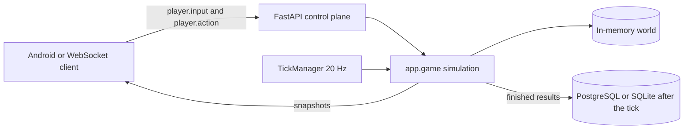

# Authoritative game runtime

The server decides what happened. A client sends an intent. The tick updates the world and publishes a snapshot.

`app/game/simulate.py` is the simulation. It has no database import. `app/main.py` drains `take_results()` after `step` and then calls `persistence_service`. High-frequency positions stay in `WorldState`.

`game_runtime.AuthoritativeSession` is the headless entry for a two-player world. It uses `GameEngine` and does not open a socket or a database connection.

## What the current tick already owns

| System | Where it is decided |
| --- | --- |
| Movement | `_move` clamps speed to 1 and keeps the player inside the map |
| Blockers | `slide` rejects a destination inside a match blocker |
| Weapons | `_shoot` checks weapon, magazine, reload, cooldown, and aim |
| Damage | The weapon table in `app/game/items.py` subtracts health |
| Death | `_eliminate` sets status and, when one combatant remains, records a result |
| Zone | `_apply_zone` uses the match radius and damage per second |
| Loot and vehicles | Pickup, use, board, and exit run in `apply_action` |
| Teams | Durable lobby teams are HTTP rows. The live match does not yet apply team revive |

These numbers are this server's development rules. They are not original Rules of Survival values.

## Client role

The Android API client sends input and draws what it is given. It does not apply damage, consume ammunition, or declare a winner. The Compose app has no 3D match renderer yet. `MapRuntime` only returns a minimap image.

A later renderer should:

1. Authenticate with the existing bearer token, then the WebSocket `auth` message.
2. Send `player.input` for movement and aim, and `player.action` for shoot, reload, pickup, use, equip, jump, discard, board, and exit.
3. Render the `state` snapshot: position, health, status, aim, kills, and the match block when one exists.
4. Interpolate other players between snapshots.
5. Predict only the local pawn, then replace that prediction when the server snapshot arrives.

Prediction and interpolation are not implemented.

## Admin

The admin surface for rules comes after the simulation that executes them. A future configuration release is `draft`, `validate`, `approve`, `publish`, then the runtime reads that version when a match starts. The running match keeps that version. No admin rule editor is added in this milestone.

## Process boundary

The tick and FastAPI still share one process, which matches ADR-0001 and ADR-0010. `TickManager` does not query SQL. Splitting the loop into another operating-system process is a later decision, using the same session and the same message names.
