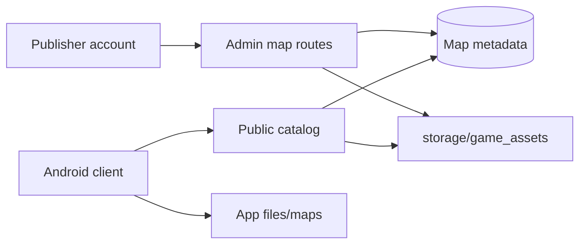

# Map system

This server publishes original map packages. A map definition is the stable identity. A map version is one immutable package. Binary files live under `storage/game_assets`. SQL stores metadata and the storage key.

The coordinate convention for schema version 1 is `local_xyz_y_up_meters`.

- X and Z are the ground plane. Y is up.
- `origin` is the minimum corner. `size` is the extent in meters.
- A point is valid when each axis is between `origin` and `origin + size`, inclusive.
- Object rotation is three degrees, `[x, y, z]`. Spawn rotation is a single yaw, `rotation_y`.
- Scale must be greater than zero on every axis.
- `engine_profile` defaults to `portable_gltf`. The value is a label. The server does not import a game engine.

## What a version contains

| Record | What it stores |
| --- | --- |
| `map_definitions` | Existing catalog row: `code`, `name`, `description`, `width`, `height`. `code` is the public slug. |
| `map_versions` | `major.minor.patch`, schema version, engine profile, bounds, status, manifest hash. |
| `map_assets` | Type, relative path, storage key, MIME type, size, SHA-256. |
| `map_regions` | Named box inside the version bounds. |
| `map_objects` | Placed object, transform, and collision, navigation, and interactive flags. |
| `map_spawn_points` | Spawn code, position, yaw, group, enabled flag. |
| `map_points_of_interest` | Name, description, position, icon. |
| `map_publications` | One row per published version. |
| `matches` | Optional `map_version_id` and `manifest_hash` when a publisher pins a version. |

Static scenery, interactive objects, and gameplay points share the placement tables. `interactive` is a flag on the object. The server does not run doors, vehicles, or loot from that flag.

## Status

`draft` can receive assets and is hidden from `GET /api/v1/maps`. `published` is immutable. `retired` is reserved in the database check and is not exposed by the current publish route.

A published version cannot be published again, and it cannot accept another asset. A later change is a new version string on the same definition.

## Storage

`MAP_STORAGE_DIR` selects the root. An empty setting uses `storage/game_assets` under the repository. The storage key is `maps/{map_id}/{version}/{relative_path}`. `write_new` refuses to replace an existing file. Clients receive asset bytes, never the key or a disk path.

## Permissions

There is no admin role. `MAP_PUBLISHERS` is a comma-separated username list. A blank list rejects every admin map route with `403` and `Map publishing is not allowed`. Public catalog, detail, manifest, and published asset routes do not require a token.

## Limits of this milestone

Schema version 1 is the only accepted schema. A different `schema_version` returns 422. There is no automatic migration from a future schema.

Published asset bytes are available without a signed URL. Draft bytes are not on the public routes.

The first published package, Island Alpha, is metadata plus one generated minimap PNG. It does not include a terrain mesh, village models, roads, or a bridge.
